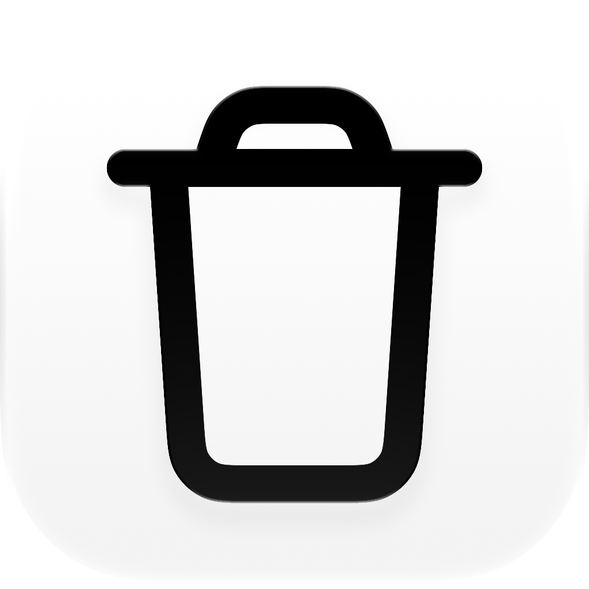
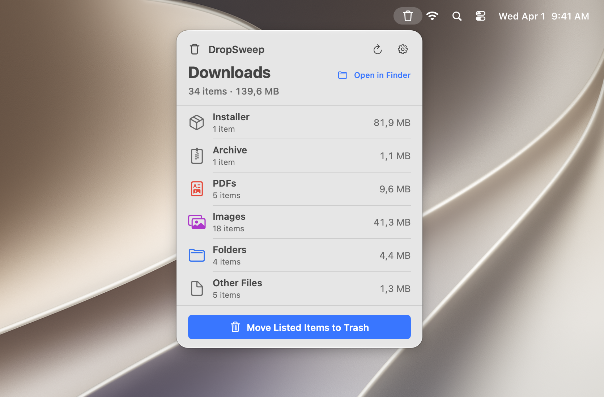

<p align="center">
  
</p>

<h1 align="center">DropSweep</h1>

<p align="center">
  <strong>A tidier Downloads folder. Right from your menu bar.</strong><br>
  A small, native macOS app that groups download clutter and moves it to the Trash.
</p>

<p align="center">
  <a href="https://github.com/timokoethe/DropSweep/releases/latest"></a>
  
  <a href="LICENSE"></a>
</p>

<p align="center">
  <a href="https://github.com/timokoethe/DropSweep/releases/latest"><strong>Download for macOS</strong></a>
  &nbsp;·&nbsp;
  <a href="https://dropsweep.itstimo.me">Website</a>
  &nbsp;·&nbsp;
  <a href="#development">Development</a>
</p>

<p align="center">
  
</p>

## Less clutter, a clearer overview

See what has piled up in Downloads, choose the categories to clear, and move your selection to the Trash when you’re ready.

| | What DropSweep does |
| :--- | :--- |
| **Always within reach** | [A compact menu bar interface](docs/features/menu-bar-access.md) without another window on your desktop. |
| **Clutter, grouped** | [Installers, archives, PDFs, screenshots, images, folders, and other files](docs/features/download-categories.md), with item counts and sizes. |
| **Your selection, remembered** | [Choose categories with checkboxes or Select All / Deselect All](docs/features/category-selection.md). Your choices are saved across app restarts. |
| **Find the largest clutter** | [Sort categories by size in either direction](docs/features/category-sorting.md), or keep the default category order. Your sort choice is saved too. |
| **Recoverable cleanup** | [Confirm before moving selected items to the macOS Trash](docs/features/move-to-trash.md), where they remain recoverable until you empty it. |
| **Ready when you are** | Optional [launch at login](docs/features/launch-at-login.md) and built-in [update checks](docs/features/app-updates.md). |

## Get started

**Requires macOS 26 or later.**

1. Download the latest version from [GitHub Releases](https://github.com/timokoethe/DropSweep/releases/latest).
2. Unzip the downloaded archive.
3. Move `DropSweep.app` to your Applications folder and open it.

Open DropSweep from the menu bar to review your Downloads. Use the category checkboxes or **Select All / Deselect All** to choose what to clear, review the selected count and size, then choose **Move Selection to Trash** and confirm. All categories are selected on first launch; later launches restore your saved selection.

## Your files stay on your Mac

DropSweep [scans your Downloads folder locally](docs/features/downloads-scanning.md) and does not upload file names or contents. Network access is only used to check for and download app updates through Sparkle.

Cleanup is limited to selected items in Downloads. Hidden items directly in Downloads and entries ending in `.crdownload`, `.download`, `.part`, `.partial`, `.opdownload`, or `.filepart` are skipped, case-insensitively. This filename filter does not detect every active download. A selected folder moves with all its contents, including hidden files and incomplete downloads. See [scanning behavior and limitations](docs/features/downloads-scanning.md).

## Development

### macOS app

Development requires Xcode 26.

Open the project in Xcode and run the `DropSweep` scheme:

```sh
open DropSweep.xcodeproj
```

The native app uses Swift 6, SwiftUI, AppKit, and Observation. Its source is in [`DropSweep/`](DropSweep/), with feature behavior and acceptance criteria in [`docs/features/`](docs/features/).

For signed builds, follow the [local signing setup](CONTRIBUTING.md#getting-started). To build without signing:

```sh
xcodebuild -project DropSweep.xcodeproj -scheme DropSweep CODE_SIGNING_ALLOWED=NO build
```

See the [implementation reference](https://itstimo.me/projects/dropsweep) for more project context.

Run the native Swift Testing suites with **Product → Test** (`⌘U`) in Xcode, or:

```sh
xcodebuild -project DropSweep.xcodeproj -scheme DropSweep -destination 'platform=macOS' CODE_SIGNING_ALLOWED=NO test
```

See the [testing guide](docs/testing.md) for coverage, temporary-file fixtures, and how to add tests.

### Website

The DropSweep website is developed separately in [`website/`](website/). Its
Next.js application code is located in [`website/app/`](website/app/), with the
landing page in [`website/app/page.tsx`](website/app/page.tsx).

Requires Node.js 24 or later. To run the website locally:

```sh
cd website
npm install
npm run dev
```

The development server is available at
[http://localhost:3000](http://localhost:3000). See the
[website README](website/README.md) for the available scripts and deployment
details.

## Contributing

Contributions are welcome. Please keep changes focused and see [CONTRIBUTING.md](CONTRIBUTING.md) before opening a pull request.
Report security issues privately as described in [SECURITY.md](SECURITY.md).

## License

DropSweep is released under the MIT License. See [LICENSE](LICENSE).
